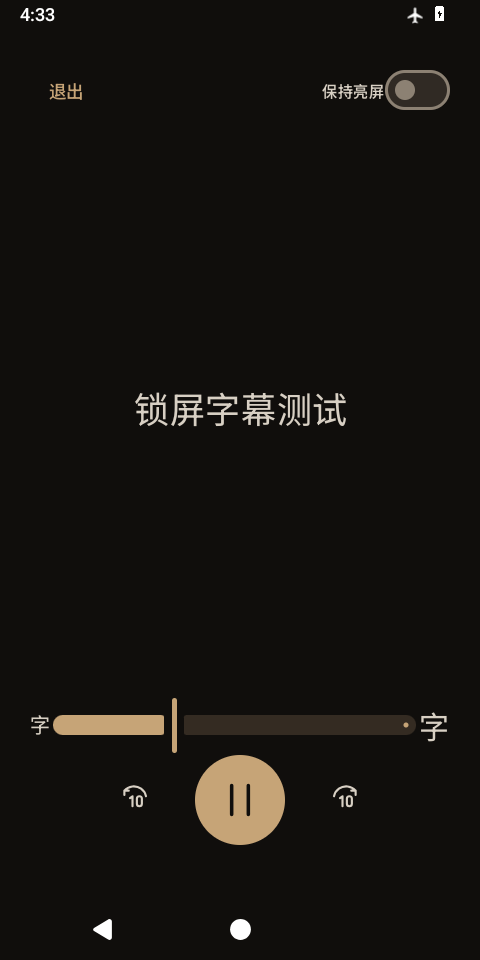

# V1.1.0 字幕测试版验证报告

本报告对应本地交付的签名测试包，不代表 GitHub 稳定版升级。测试时间：2026-09-26 至 2026-09-27。没有取得用户目标手机，本版不能宣称所有厂商锁屏兼容。

## 实现范围

- 转换窗口可选内置文本字幕或框选画面 OCR，覆盖单个、批量分别导出和拼接；默认关闭。
- OCR 模型、字典和 ONNX Runtime 随包提供，无运行时下载、语音识别或翻译。
- 授权目录内配对保存音频与 SRT，重名增加后缀；原视频和导出音频分别关联字幕。
- 字幕失败保留已完成音频；重试复用音频与时间线检查点。中断文件通过任务记录清理；撤权时保留待清理记录。
- 普通播放页同步显示、SRT 导入、时间偏移、文件夹同名匹配和独立纯播放页。
- Room 3 → 4 显式迁移，无破坏性重建。

## 验证记录

签名 APK：`Zhenbo-1.1.0.apk`，124,709,929 字节（124.7 MB / 118.9 MiB）。V1.0 包为 30,328,513 字节，本次增加约 94.4 MB，主要来自模型及四种 ABI 的推理库。

SHA256：`5180b71ee6e9e9ee43cc5c58db0c916b21038b4e458b61c07383915c74daad4e`。应用实现提交：`fabac2e6744331dd4c66ee48c70222c7c677cd22`；后续提交仅补充测试脚本与交付文档。完整日志位于本地 `artifacts/v11-final-regression-awake-api36.txt`、`artifacts/v11-final-api37-rerun.txt`，APK 审计位于 `artifacts/delivery-audit-v1.1-api36.json` 与 `artifacts/delivery-audit-v1.1-api37.json`。

- Release 与 AndroidTest 编译成功；16 项 JVM 测试通过。
- Lint Release：0 错误，53 警告、2 提示，主要为已有依赖升级、KTX / 样式与保守存储空间检查建议。
- 5 个固定 OCR 资源校验通过，合计 21,584,560 字节；APK 内的模型与 10 份许可证文件与源码一致。
- 签名、版本和已安装 APK SHA256 检查通过；非 Debug，关闭云备份，不含 INTERNET、ACCESS_NETWORK_STATE、RECORD_AUDIO、MANAGE_EXTERNAL_STORAGE 权限。
- APK 16 KB ZIP 对齐通过；所有 64 位 ELF 的 LOAD 段满足 16 KB 对齐。32 位库不据此宣称支持 16 KB 系统；没有在实体 16 KB 页设备上运行。

Android 16 / API 36、x86_64 AOSP 模拟器，无 Google Play 服务，飞行模式开启。最终签名包 6 项字幕专项测试全部通过（61.523 秒）：

| 验证内容 | 结果 |
|---|---|
| 中 / 英 / 日清晰静帧 OCR | 3 张样本逐字匹配，含标点 |
| 顺序视频解码 + 4 fps OCR | 3 秒字幕视频识别通过 |
| 内置字幕 | MKV SubRip、ASS；MP4 tx3g、WebVTT；两条字幕的完整文本、换行与开始 / 结束时间通过（容差 50 ms） |
| 配对导出与恢复 | 原音质与 AAC 三段拼接、无字幕间隔、音频保存后字幕失败 / 重试、音频哈希不变、中断记录清理通过 |
| 批量混合与同名匹配 | 无字幕文件留在所选目录；缓存关联删除后重新匹配恢复；同名 M4A / WAV 不自动匹配一份 SRT |
| 数据迁移 | Room 3 → 4，集合保留，新字幕表可读写 |
| 密码锁上的纯播放页 | 字幕可见、设备仍锁定、实际暂停 / 继续成功、默认保持亮屏标志关闭 |

Android 16 全量回归：`OK (77 tests)`，452.251 秒，75 项通过、2 项前置条件不满足而跳过，无失败。覆盖旧版媒体扫描 / 封面、集合编辑拖动、队列恢复、损坏文件、计时、定时冲突、音频处理、取消与恢复，并包含上述字幕专项。Room 1 → 4、2 → 4、3 → 4 的迁移用例通过。

跳过的是依赖外部两阶段运行的 `ReinstallScanTest` 和 `V10UpgradeTest`；不能将其记为已通过实际卸载重装或 APK 两阶段升级。独立 Room 迁移和目录字幕关联恢复已经测试。

测试期间曾遇到模拟器清除测试 PIN 后保留旧解锁界面，导致后续界面测试无法显示。通过模拟器屏幕复位后，全量回归通过；测试启动脚本已加入该复位步骤。应用没有设置或清除用户密码的代码，这些操作只存在于受模拟器限制的测试中。

Android 17 / API 37、x86_64 模拟器、飞行模式：6 项字幕专项复测全部通过，81.444 秒。首次运行的锁屏窗口查询曾返回空节点；锁屏专项单独复查通过（11.278 秒）并核对截图，随后完整 6 项复测通过。该首次冷唤醒时序现象仍保留在记录中，不据此保证所有厂商的唤醒行为。两台模拟器安装的 APK SHA256 均与交付文件一致。

Android 16 的一次专项运行中，中 / 英 / 日三张清晰样本全部逐字匹配（包括标点），总耗时 2,061 ms；采样进程 PSS 为 213,435 KB。3 秒字幕视频的顺序解码与 OCR 耗时 10,610 ms，结束时采样 PSS 为 100,912 KB。两项 PSS 都不是峰值测量，模拟器速度也不能代表手机；长视频 OCR 的等待时间可能很长。

## 指标解释与限制

OCR 合成样本是清晰、固定位置横排文字的小规模冒烟测试，不足以代表任意 ASMR 视频达到 95% 准确率。繁体中文、复杂背景、花字、滚动字幕和快速闪现字幕没有取得独立准确率统计。4 fps 采样和连续帧稳定规则不保证保留不足 500 ms 的字幕。

字幕播放按播放器实际位置每 100 ms 更新，可响应暂停、拖动、倍速和切换；这只是实现刷新间隔，不能当作实测端到端同步误差。微秒时间线和短片拼接用例不能替代小时级素材的漂移测量。尚未完成全面非零起始时间、多轨、图片字幕、编码延迟及不同采样率组合的字幕专项验收。

SAF 不提供双文件事务；音频已保存而字幕未完成时会保留音频并报告部分失败。文件创建到任务记录提交之间仍有很小的系统中断窗口，不能宣称任意断电时绝无残缺文件。目录撤权、磁盘写满和真实系统杀进程需要进一步故障注入验证；不得把模拟恢复记录等同于覆盖全部故障时序。

## 平台范围

| 平台 | 本次范围 |
|---|---|
| Android 10 / API 29 | 未运行本次字幕设备测试；仅 minSdk 与静态 API 检查 |
| Android 13 / API 33 | 未运行本次字幕设备测试 |
| Android 14 / API 34 | 未运行本次字幕设备测试 |
| Android 16 / API 36 | AOSP x86_64 模拟器，75 项通过、2 项跳过；无 Google 服务、飞行模式 |
| Android 17 / API 37 | x86_64 模拟器，6 项字幕专项复测通过；飞行模式，未重跑全部旧功能 |
| 实体手机、厂商锁屏 / 省电策略 | 未验证 |

模拟器关闭了宿主机音频输出，因此播放用例验证的是播放器状态、进度和控制响应，不等同于真实扬声器、蓝牙或有线耳机的听感与输出验证。

纯播放页默认不保持亮屏，不解除密码锁、不主动唤醒屏幕。屏幕关闭后停止页面高频更新，返回页面重新同步。通知入口不含字幕正文，但系统是否要求解锁、是否回到该页面，以设备实际行为为准。

## 可复现入口

- `tools/build.ps1`：Release 编译、AndroidTest 编译、JVM 测试与 Lint。
- `tools/verify_ocr_assets.py`：固定模型、配置和字典 SHA256。
- `tools/test_device.py --serial <测试设备> --apk artifacts/Zhenbo-1.1.0.apk --test-class app.jingting.localplayer.V11SubtitleTest --report artifacts/v11-device.txt`。
- `V11SubtitleTest` 的密码锁用例只允许一次性模拟器，并在结束后清除测试密码，不应在个人手机上运行。
- `tools/package.py`：验证签名、版本、权限和非 Debug 构建，再生成源码与 SHA256 清单。

## 锁屏画面

下图为 Android 16 模拟器的密码锁状态。测试同时检查设备仍锁定、页面处于前台、默认亮屏标志关闭；模拟器结果不能替代厂商真机。

